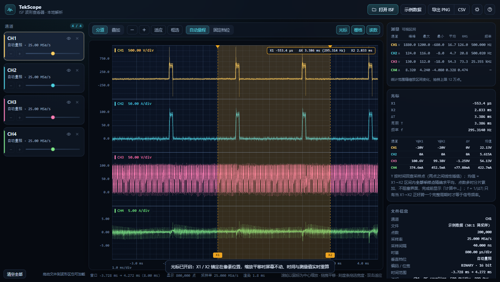

# TekScope · 网页示波器

在浏览器里直接打开泰克（Tektronix）示波器导出的 **ISF** 波形文件，多通道显示、缩放、光标测量、导出，全部在本地完成，**文件不会上传到任何服务器**。

纯静态页面（HTML + CSS + 原生 JS，零依赖、零构建），可直接托管在 GitHub Pages，全世界可访问。



## 功能

| 分类 | 说明 |
| --- | --- |
| 加载 | 打开 / 拖放 `.isf` 文件，一次可多选；按 CH1–CH8 自动排序，同编号自动替换；支持多文件重复加载 |
| 显示 | 分道（每道 4 格）/ 叠加（8 格）两种视图；可逐通道显示隐藏、改色（按通道固定配色）、移除 |
| 缩放 | 滚轮以指针为中心缩放、拖拽平移、双击适应、`Alt`+拖拽或右键拖拽框选放大 |
| 垂直 | 「自动量程」按可视数据吸附到 1-2-5 档位；「固定档位」用文件里的 V/div，可 ± 调整与位移 |
| 测量 | 当前可视区间的峰峰值、最大/最小、平均、RMS、频率（按回差找上升沿取周期中位数，噪声不报频率） |
| 光标 | 双时间光标 X1/X2（线上有名称标签，指针移到线上变左右箭头），读数栏给出 X1/X2 时刻、ΔX、1/ΔX，以及各通道在两条光标处的 Y 值、ΔY 和 X1→X2 区间平均值；指针停在光标线上时滚轮以该线为锚点缩放，线不会随缩放漂走，跑出视野时光标名后带 `‹`/`›` 指向 |
| 读数 | 悬停十字线与浮窗，显示该时刻每个通道的采样值 |
| 导出 | 一键 PNG 截图；CSV 导出可视区间数据（自动抽样，最多 20 万行） |
| 其它 | 深/浅主题（记忆偏好）、快捷键、响应式（手机/平板可用）、离线可用 |

### 支持的文件格式

- `ENCDG`：`BINARY`（`BIT_NR` 8/16/32/64，`BN_FMT` RI / RP / FP，`BYT_OR` MSB / LSB）与 `ASCII`
- 时间轴：`XINCR`、`XZERO`、`PT_OFF`；电压轴：`YMULT`、`YOFF`、`YZERO`；同时读取 `VSCALE`、`HSCALE`、`WFID` 等元信息
- 文件头按 `:CURVE #<n><len>` 块头解析，容忍块头后的空白字节

> 实测：4 通道 × 1000 万点（每文件 20 MB，共 80 MB）可一次性加载，全览渲染约 3–12 ms。

## 快速开始

方式一：直接双击 `index.html`（可用，但从 `file://` 打开时浏览器禁止读取 `samples/`，会自动退回合成演示波形）。

方式二（推荐）：起一个本地静态服务器

```bash
python -m http.server 8000
# 然后访问 http://localhost:8000
```

## 部署到 GitHub Pages

```bash
git init
git add .
git commit -m "feat: web oscilloscope for Tektronix ISF"
git branch -M main
git remote add origin https://github.com/<你的账号>/<仓库名>.git
git push -u origin main
```

然后在仓库 **Settings → Pages → Build and deployment** 里把 Source 选为 `Deploy from a branch`，分支 `main`、目录 `/ (root)`，保存后等一两分钟即可通过
`https://<你的账号>.github.io/<仓库名>/` 访问。

注意事项：

- 原始波形（每个 20 MB、四通道 80 MB）**不要提交**，`.gitignore` 里已排除 `/*.isf`；页面通过「打开 ISF」在本地读取，不需要把它们放到服务器上。
- 仓库里只保留 `samples/` 下 4×391 KB 的示例数据，用于首屏演示；页面统一从 `./samples/CH1.isf … CH4.isf` 读取（首屏默认波形与「示例数据」按钮共用同一组路径），放在仓库根或子路径下都能正确解析。
- 若以后换到自定义域名或子路径，页面里全部用相对路径，无需改代码。

## 目录结构

```
.
├── index.html            页面结构
├── styles.css            设计与布局（深/浅主题、响应式）
├── js/
│   ├── isf-parser.js     ISF/WFM 二进制解析（无依赖，可在 Node 中复用）
│   ├── waveform.js       通道模型：多分辨率 min/max 金字塔、列极值、测量
│   ├── renderer.js       Canvas 渲染：栅格、轨迹、光标、框选、读数
│   └── app.js            交互、文件加载、导出
├── samples/              四通道示例（原始数据 50:1 抽取，保留原始标定）
└── tools/
    └── make-samples.js   从原始 ISF 生成 samples/
```

## 示例数据是怎么来的

`tools/make-samples.js` 读取原始 20 MB 的 ISF，每 50 个采样点取 1 个（`XINCR × 50`，时间跨度不变），重新封装成标准 ISF：

```bash
node tools/make-samples.js
```

因为走的还是同一个 `isf-parser.js`，这同时也是解析器的一条回归用例。

## 实现要点

- **大文件渲染**：每个通道预建 min/max 金字塔（桶 16 / 256 / 4K / 64K / 1M），渲染时按「每列点数」选层，1000 万点全览每帧只读几千个桶，毛刺不会丢。
- **零拷贝解码**：`BYT_OR` 与本机字节序一致时直接建类型化视图；不一致时用 `Uint8Array` 批量换序，比逐点 `DataView` 快数倍。
- **自动量程**：可视区间极值 → 吸附 1-2-5 档位 → 中线对齐半格，刻度读数永远是整齐的数。
- **频率测量**：以中值为阈值加 8% 回差找上升沿，取周期中位数；只有 60% 以上周期落在中位数 ±20% 内才报频率，避免噪声给出假频率。

## 快捷键

| 键 | 功能 |
| --- | --- |
| `+` / `-` | 时间轴缩放 |
| `←` / `→` | 平移 |
| `R` | 适应全部 |
| `C` / `G` / `H` | 光标 / 栅格 / 悬停读数 |
| `Z` | 框选放大 |
| `1`–`4` | 切换当前通道 |
| `空格` | 分道 / 叠加 |

## License

MIT
